<table align="center">
  <tr>
    <td valign="top"></td>
    <td valign="top"></td>
  </tr>
</table>

  

<h3>Applied AI Engineer / Architect</h3>

<i>Generative AI · RAG · Agent Orchestration · LLM Evaluation — production systems for government, healthcare and social media in the UAE.</i>

  
  
  
  

 

<h2 align="center">About Me</h2>

<table width="100%">
<tr>
<td width="48%" valign="top">

### Who am I?

- **Customer-facing AI engineer and architect** — 15+ years translating complex stakeholder needs into production systems.
- **Architected and shipped a production Arabic RAG platform** for a Dubai government office: hybrid search, multi-agent orchestration, versioned prompts, regression-gated evaluation.
- **External AI consultant** — took ReguLense from a scoped use case to a live production system for a healthcare advisory firm.
- **Arabic NLP depth** — tashkeel handling, morphological normalization, dialect detection (MSA, Gulf, Nabati, Egyptian), polysemy resolution.
- **Studying** — DBA in AI (Walsh College) and the UT Austin Post Graduate Program in AI & ML. MCA, Amity University.

> *Discovery → architecture → demo → handover. I build the system, then make sure the people who own it can run it.*

</td>
<td width="52%" align="center" valign="middle">

</td>
</tr>
</table>

<h2 align="center">Tech Stack</h2>

<table width="100%">
  <tr>
    <td width="50%" valign="top">
      <h3>Languages & Backend</h3>
      
        
      <h3>Data & Vectors</h3>
      
       pgvector · hybrid search · full-text search · embeddings
        
      <h3>Cloud & Delivery</h3>
      
    </td>
    <td width="50%" valign="top">
      <h3>LLMs & Agents</h3>
      

        
        
        
        
        
        
      

      Agentic workflows · tool calling · task decomposition · validator gates · human-in-the-loop
      <h3>Retrieval & Evaluation</h3>
      
RAG · Reciprocal Rank Fusion · multi-stage reranking · chunking strategies · Docling · precise citations · LLM evaluation harnesses · regression testing · LangSmith tracing

      <h3>Arabic NLP</h3>
      
Morphological normalization · tashkeel handling · dialect detection · code-switching detection · polysemy resolution · text classification

    </td>
  </tr>
</table>

<h2 align="center">Featured Projects</h2>

<table width="100%">
  <tr>
    <td width="50%" valign="top">
      <h3>Hamdan</h3>
      
Production Arabic RAG &amp; agentic system for a Dubai government office.

      
<code>Python</code> <code>LangGraph</code> <code>FastAPI</code> <code>pgvector</code> <code>n8n</code> <code>LangSmith</code> <code>AWS</code>

      <ul>
        <li>4-signal hybrid retrieval (semantic + lexical + entity + emotion), RRF, multi-stage reranking</li>
        <li>Research agents, editor agents and a validator gate with cross-category regression testing</li>
        <li>Self-healing prompts: versioned, auto-evaluated, regression-gated</li>
        <li>150+ query evaluation harness with Arabic polysemy test suites</li>
      </ul>
    </td>
    <td width="50%" valign="top">
      <h3><a href="https://neohealth-gpzo.onrender.com">ReguLense</a> · <a href="https://github.com/haitham72/NeoHealth">code</a></h3>
      
Version- and jurisdiction-aware RAG for UAE health regulation. Live.

      
<code>Python</code> <code>FastAPI</code> <code>pgvector</code> <code>OpenAI</code> <code>React</code> <code>Docling</code> <code>Docker</code>

      <ul>
        <li>pgvector + PostgreSQL full-text fused via RRF; abstains below a calibrated confidence floor</li>
        <li>Tracks in-force vs. superseded versions; DHA / DoH / MOHAP filter</li>
        <li>PDF citation highlighting from per-element bounding boxes stored at ingest</li>
        <li>Automatic failover to a backup LLM provider, per-client rate capping</li>
      </ul>
    </td>
  </tr>
  <tr>
    <td width="50%" valign="top">
      <h3>Mirsal Builder</h3>
      
Local, private AI Telegram sticker-generation platform.

      
<code>Python</code> <code>FastAPI</code> <code>LangGraph</code> <code>pgvector</code> <code>Redis</code> <code>React</code>

      <ul>
        <li>LangGraph chat over Studio functions with human approval gates G1–G5</li>
        <li>Ticket-first paid provider calls so a crash never double-charges</li>
        <li>44 deterministic checks across 9 stages, Telegram pack delivery</li>
      </ul>
    </td>
    <td width="50%" valign="top">
      <h3>Faz3</h3>
      
Arabic comment classification for large-scale social media moderation.

      
<code>Python</code> <code>Supabase</code> <code>Arabic NLP</code>

      <ul>
        <li>Dialect-aware classification (MSA, Gulf, Egyptian) with code-switching detection</li>
        <li>Confidence scoring and a human-in-the-loop moderator queue</li>
        <li>941 comments in 32.6 s; human escalation cut from 41% to 10.5%</li>
      </ul>
    </td>
  </tr>
</table>

<h2 align="center">Engineering Experience</h2>

<table width="100%">
  <tr>
    <td width="33%" valign="top">
      <h3>Retrieval</h3>
      <ul>
        <li>Hybrid &amp; semantic search</li>
        <li>Reciprocal Rank Fusion</li>
        <li>Multi-stage reranking</li>
        <li>Structure-aware chunking</li>
        <li>Confidence abstention</li>
        <li>Precise citations</li>
      </ul>
    </td>
    <td width="33%" valign="top">
      <h3>Agents &amp; Evaluation</h3>
      <ul>
        <li>Multi-agent orchestration</li>
        <li>Validator gates</li>
        <li>Self-healing prompts</li>
        <li>Regression-gated releases</li>
        <li>Error taxonomies</li>
        <li>Observability &amp; tracing</li>
      </ul>
    </td>
    <td width="34%" valign="top">
      <h3>Delivery</h3>
      <ul>
        <li>Technical discovery</li>
        <li>Solution architecture</li>
        <li>Stakeholder demos</li>
        <li>Documentation &amp; handover</li>
        <li>LLM provider failover</li>
        <li>Containerized deployments</li>
      </ul>
    </td>
  </tr>
</table>

<h2 align="center">GitHub Activity</h2>

  
  
   
  
   
  <picture>
    <source media="(prefers-color-scheme: dark)" srcset="https://raw.githubusercontent.com/haitham72/haitham72/output/snake-dark.svg"/>
    
  </picture>

 

  <b>Open to Senior / Mid AI Engineer roles — UAE & GCC, remote EU/US.</b>
   Arabic (native) · English (professional)

